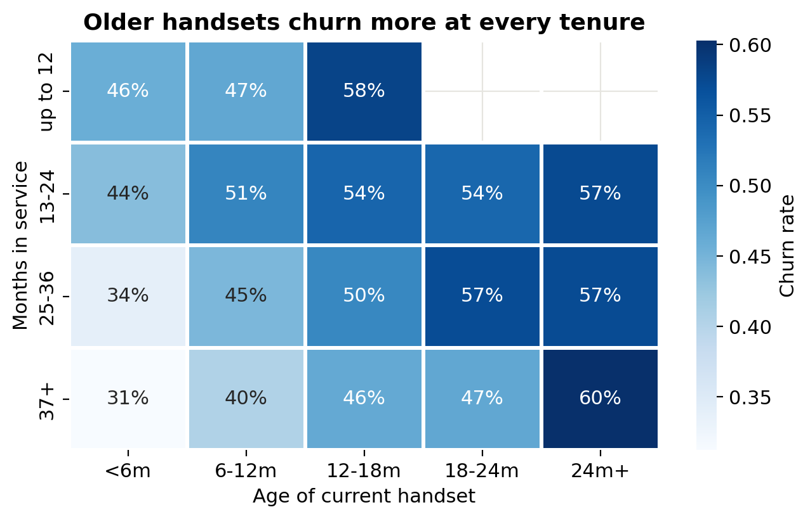
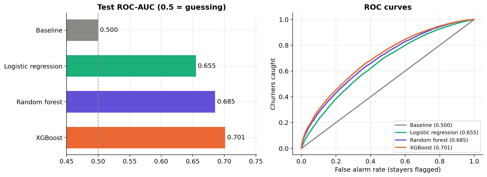
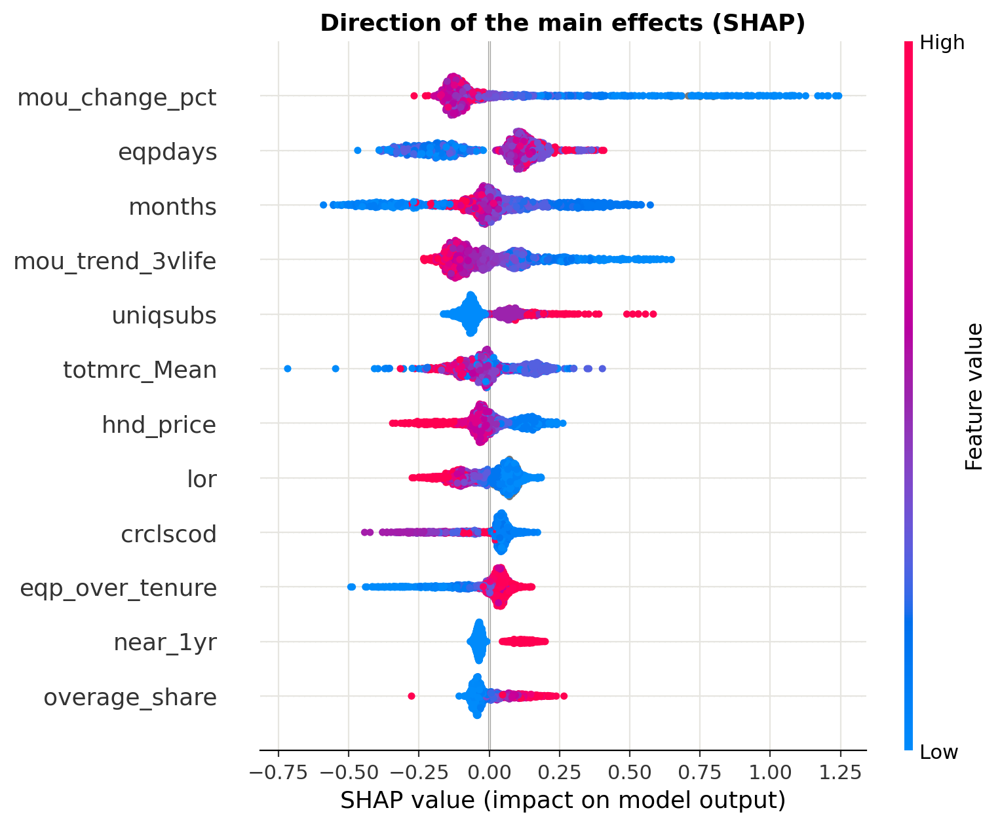

# Telecom Churn Prediction and Retention Strategy

Predicting which customers of a telecom operator will leave, and turning those predictions into a targeted retention campaign with a measurable return.

Built for the GCI World 2026 data science course (Matsuo-Iwasawa Lab, University of Tokyo).

## The problem

About half of the 100,000 customers in the dataset churned within 31 to 60 days of the observation date, taking **$34.4M of yearly revenue** with them. Churn is similar at every spending level, but the top 30% of customers by spend account for **54% of the lost revenue**. A retention campaign therefore has to weigh each customer's value, not only their risk.

## What drives churn

Three warning signs stand out in the data:

- **Ageing handset:** churn rises from 42% for handsets under 6 months old to 58% for handsets over 2 years old
- **The 1-year mark:** customers at 10 to 12 months of service churn at 58%, against 32% before month 9, which points to contracts ending
- **Falling usage:** customers whose monthly minutes dropped by more than 200 churn at 55%

The handset effect holds at every tenure level, even for loyal customers of 37+ months (31% churn on a new handset vs 60% on one older than 2 years):

**Unexpected finding:** customers who call customer care churn *less* (45% with 3+ calls a month vs 52% with none), and the lightest users churn most. Quiet customers leave; engaged ones stay. So the strategy does not chase complaints.

## Approach

1. **Data:** customer and usage tables merged one to one (100,000 customers, 98 columns). Missing household data kept as its own category instead of dropping rows.
2. **Feature engineering:** 18 new features, including handset age relative to tenure, recent vs long-term usage, call failure rate, overage share of the bill, and a contract anniversary flag (116 features in total).
3. **Modelling:** four models compared on a 70/30 train/test split with 5-fold cross-validation on the training set.
4. **Metric:** ROC-AUC, because a retention campaign works down a ranked list of customers, so ranking quality is what matters. Accuracy, precision, recall and F1 are also reported.
5. **Interpretation:** feature importance and SHAP, with each driver marked as actionable (handset, usage trend, plan, call quality) or not (demographics, usage volume).
6. **Business simulation:** customers ranked by *revenue at risk* (churn probability × monthly bill) and matched to one retention offer each, then net impact calculated against random contact.

## Model results

| Model | Test ROC-AUC | CV ROC-AUC | Accuracy | Precision | Recall | F1 |
|---|---|---|---|---|---|---|
| Baseline (always "stay") | 0.500 | 0.500 | 0.504 | 0.000 | 0.000 | 0.000 |
| Logistic regression | 0.655 | 0.655 | 0.609 | 0.605 | 0.608 | 0.607 |
| Random forest | 0.686 | 0.686 | 0.631 | 0.626 | 0.638 | 0.632 |
| **XGBoost** | **0.701** | **0.701 ± 0.002** | **0.644** | **0.640** | **0.643** | **0.642** |

XGBoost was selected. Customers in the top 10% of predicted risk churn at **81%**, against a 50% average (1.64× lift), while the bottom 10% churn at only 18%.

## What the model learned

The SHAP plot shows the direction of each effect. A sharp drop in usage (`mou_change_pct`) and an older handset (`eqpdays`) push churn risk up the most, and being near the 1-year mark (`near_1yr`) raises it as well. More expensive handsets (`hnd_price`) are linked to lower churn.

## The retention strategy

Each customer gets one offer, matched to the most likely reason they would leave:

| Offer | Who gets it | Group churn rate |
|---|---|---|
| Handset upgrade | Handset older than 12 months | 54% |
| Renewal offer | 10 to 15 months in service, around contract end | 58% |
| Plan right-sizing | Usage fell over 25%, or overage over 15% of the bill | 41% |
| Loyalty credit | Everyone else on the list | 33% |

## Business impact

Net impact = 12 months of revenue from customers saved minus offer cost, scaled to 100,000 customers:

| Customers contacted | Model ranking | Random contact |
|---|---|---|
| Top 10% | $1.77M | $0.33M |
| **Top 20%** | **$2.56M** | **$0.66M** |
| Best depth (top 65%) | $3.69M | $3.26M (contact everyone) |

The result stays positive in all 20 stress-test scenarios, from half the assumed success rate to double the assumed offer cost. At a realistic 2% monthly churn rate, expensive offers only pay for the highest-value tier, so the proposal combines costly handset deals for the top 1% with low-cost digital offers below.

## Limitations

- Offer costs and success rates are assumptions; a pilot with a control group is needed to measure the real effect
- The dataset over-represents churners (49.6% churn vs about 1 to 3% a month at real carriers)
- The model shows association, not cause

## Repository

- `telecom-churn-retention.ipynb`: full analysis, from data loading to business impact
- `*.png`: key charts

## Data

The dataset was provided for the course and is not included in this repository.

## Tools

Python, pandas, scikit-learn, XGBoost, SHAP, matplotlib, seaborn
